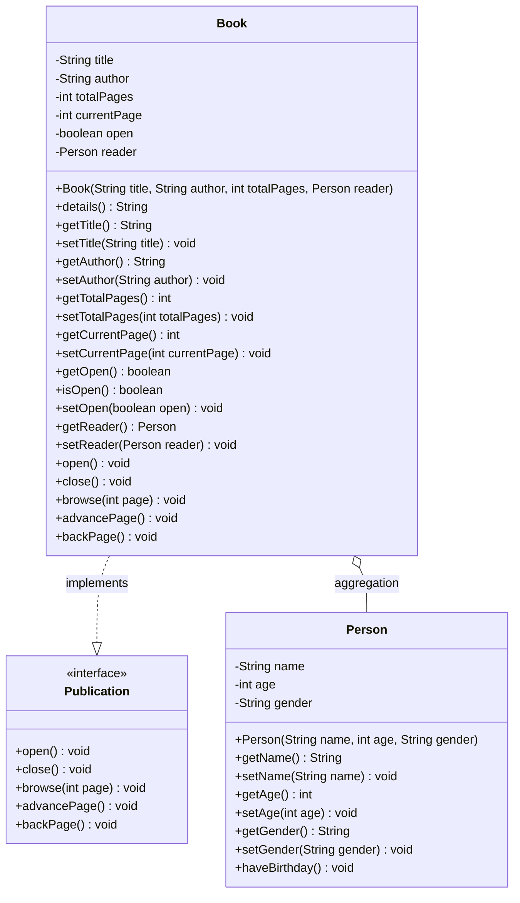

# Technical Documentation and OOP Architecture

Academic project for an Object-Oriented Programming course.

## Class Diagram

## Applied OOP Concepts

1. **Abstraction:** `Person` and `Book` expose essential state and behavior.
2. **Encapsulation:** Fields are private and modified through getters and setters.
3. **Aggregation:** `Book` can hold a reference to a `Person`; both objects have independent lifecycles.
4. **Interface and polymorphism:** `Publication` defines the reading contract implemented by `Book`.
5. **State and boundaries:** A book starts closed at page zero. Browsing outside valid boundaries resets the current page to zero. Advancing and going back never exceed the page boundaries.
6. **Defensive validation:** Constructors and setters reject empty text, negative ages, zero or negative page counts, and invalid current-page values.
