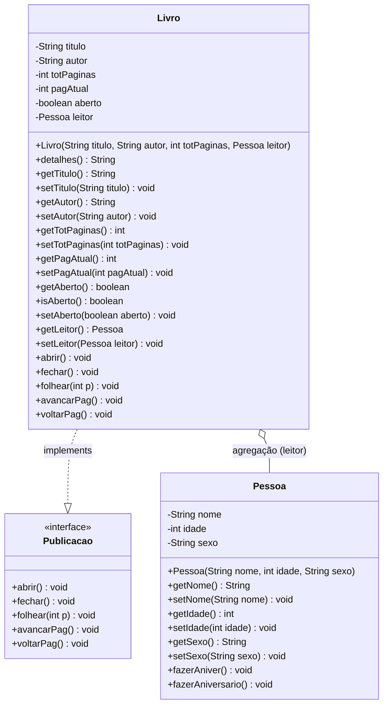

# DOCUMENTAÇÃO TÉCNICA E ARQUITETURA POO

Projeto acadêmico desenvolvido para a disciplina de **Programação Orientada a Objetos (POO) - Trabalho Prático (1ª Etapa)**.
Professor: Állan Stieg.

---

## 1. Diagrama de Classes (UML)



---

## 2. Conceitos Fundamentais de POO Aplicados

1. **Abstração:** Modelagem das entidades `Pessoa` (`nome`, `idade`, `sexo`) e `Livro` (`titulo`, `autor`, `totPaginas`, `pagAtual`, `aberto`, `leitor`) com seus atributos e métodos essenciais.
2. **Encapsulamento Estrito:** Todos os atributos são declarados como `private` e manipulados exclusivamente por Getters e Setters, seguindo os Slides 8, 14, 15, 16, 20, 21 e 22.
3. **Agregação:** Associação fraca entre `Livro` e `Pessoa` (`leitor: Pessoa`). O leitor pode existir independentemente de qualquer livro e um livro possui uma referência a um leitor.
4. **Interface e Polimorfismo:** Interface pura `Publicacao` formalizando o contrato de navegação de leitura (`abrir()`, `fechar()`, `folhear(int p)`, `avancarPag()`, `voltarPag()`), implementada por `Livro` através de `@Override`.
5. **Regras de Negócio e Delimitação de Estado:**
   - O livro é sempre instanciado fechado (`aberto = false`) e na página zero (`pagAtual = 0`), conforme o Slide 32.
   - Ao folhear para além da capacidade do livro ($p > totPaginas$) ou para páginas negativas, a página atual é redefinida para `0` (Regra formal do Slide 37).
   - Avanço e recuo respeitam os limites físicos (`avancarPag()` não ultrapassa `totPaginas` e `voltarPag()` não reduz abaixo de `0`).
6. **Formatação de Saída (Slide 35):** O método `detalhes()` gera exatamente a saída esperada:
   ```text
   Livro:Título= POO na prática
   , Autor= Allan Stieg
   , Total de Paginas= 300
   , Página Atual= 0
   , Aberto?= false
   , Leitor=Marcos Idade:21 Sexo:M
   ```
   (Sem espaço após `Livro:`, e com as quebras e vírgulas exatas do modelo).
7. **Objetos Sempre Válidos:** Construtores e setters contêm validações defensivas contra strings vazias, idades negativas e número total de páginas menor ou igual a zero.
